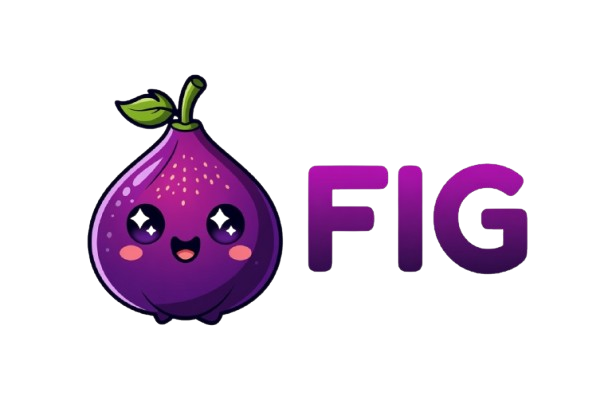
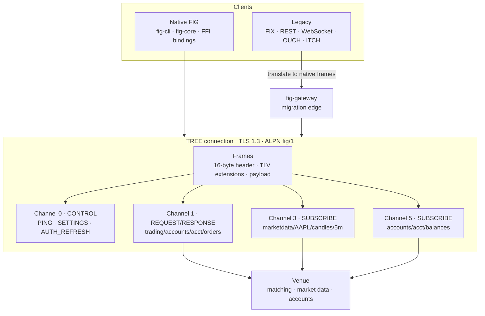
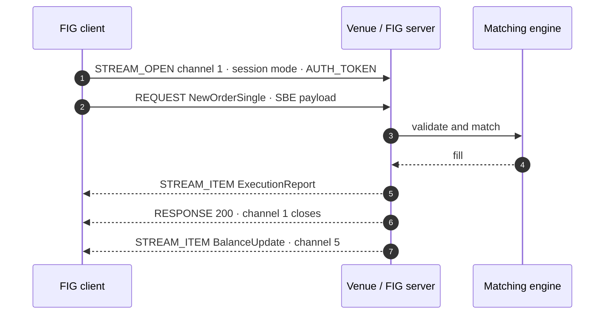
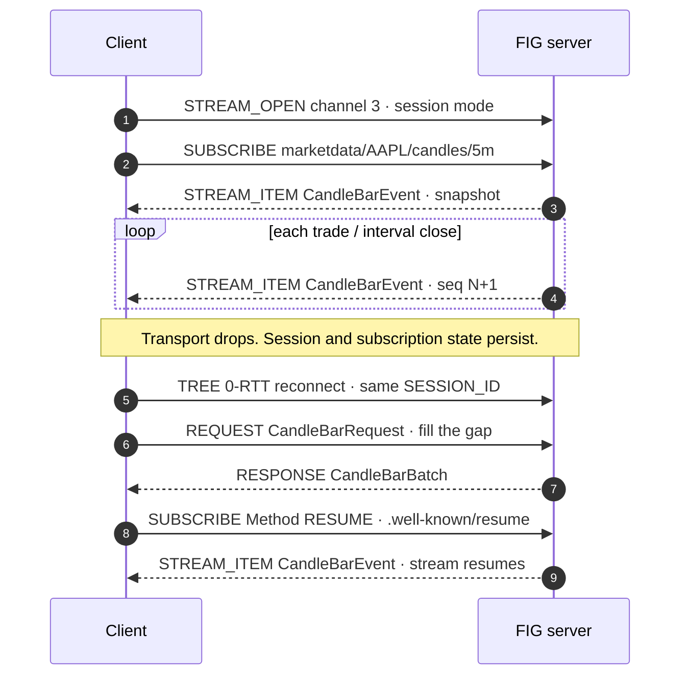
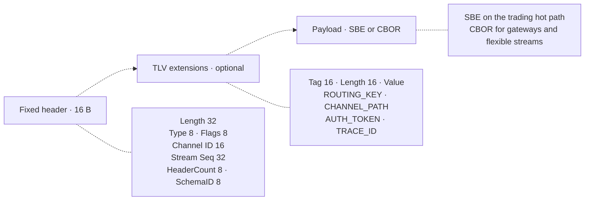

<p align="center">
  
</p>

<h1 align="center">FIG — Fast Interchange Gateway</h1>

<p align="center">
  <b>One encrypted connection for orders, market data, and private account streams.</b><br>
  A schema-native binary protocol for trading systems, with FIX / REST / WebSocket / OUCH / ITCH gateways for migration.
</p>

<p align="center">
  <a href="https://github.com/Macho0x/FIG/actions/workflows/ci.yml"></a>
  <a href="#license"></a>
</p>

**FIG is a wire protocol — not a matching engine, exchange, or API-key issuer.** It defines how
messages move and how already-issued credentials ride on the wire, at the same layer as FIX, REST,
and WebSocket. Venues own matching, funding, and credential issuance; FIG libraries validate
credentials on the wire. See [SPEC.md §1.3](SPEC.md).

> **FIG** = the protocol · **TREE** = its QUIC transport (TLS 1.3, ALPN `fig/1`) · **FSL** = its schema IDL.

---

## Contents

[Why FIG](#why-fig) · [Try it in 60 seconds](#try-it-in-60-seconds) · [What FIG gives you](#what-fig-gives-you) ·
[How the flow works](#how-the-flow-works) · [Client code](#client-code) ·
[Languages](#languages) · [Adopting FIG](#adopting-fig) · [Security](#security) ·
[Documentation](#documentation) · [Status](#status) · [Contributing](#contributing)

---

## Why FIG

Today's trading stacks are three protocols pretending to be one — three auth models, three error
models, three observability pipelines. FIG collapses them onto a single connection.

| | **FIG (native SBE)** | FIX 4.4 ASCII | HTTP/1.1 + JSON | WebSocket |
|---|---|---|---|---|
| **Minimum header** | **16 B** fixed, TLVs only when needed | 200–500 B | 200–800 B | 2–10 B framing only |
| **Parse cost** | **~0.3 μs** SBE decode | ~4.8 μs tag=value parse | ~1.8 μs headers only | Application-defined |
| **Handshake to first message** | 1 RTT new · **0 RTT resumed** | 4 RTTs (TCP + TLS + Logon) | 3–5 RTTs | 2–3 RTTs |
| **Multiplexing** | **65,535 channels/connection** | 1 session/connection | 6 streams (browser) / HTTP/2 | 1 stream/connection |
| **Resume after drop** | 0-RTT, sequenced replay | Full reconnect | Stateless — no session | Full reconnect |
| **Schema, ordering, auth** | Schema ID + per-channel seq + `AUTH_TOKEN` | tag=value, session seq, Logon | None — app-defined | None — app-defined |

Header bytes are not the whole cost. WebSocket's 2–10 B is framing only; FIG's 16 B also carries
the channel, sequence, schema, and flags, while FIX and JSON repeat routing, auth, and IDs in every
message. Parse and handshake figures are single-host in-repo measurements — methodology and
caveats: [docs/BENCHMARKS.md](docs/BENCHMARKS.md); normative table: [SPEC.md §14](SPEC.md).

Beyond the wire, one auth model (`AUTH_TOKEN` / mTLS), one error model, and trace/correlation IDs
in every frame replace four per-protocol stacks.

---

## Try it in 60 seconds

Requires a Rust toolchain (edition 2021, Rust 1.97+).

```bash
git clone https://github.com/Macho0x/FIG.git && cd fig

# Terminal 1 — reference venue on 127.0.0.1:8443, exporting its dev certificate
cargo run -p fig-exchange-sim -- --print-ca .fig/dev-ca.pem

# Terminal 2 — seven demos over one connection
FIG_TLS_CA=.fig/dev-ca.pem cargo run -p fig-cli
```

Clients verify TLS **by default**; `FIG_TLS_CA` pins the simulator's self-signed development
certificate, so you never have to disable verification (in production you point at your real CA).
The simulator is a **reference venue** — in-memory matching and dev tokens, not production
infrastructure. Walkthrough: [docs/TUTORIAL.md](docs/TUTORIAL.md).

Keep legacy clients on day 1 — run the gateway in front of the same backend.
REST `:8080`, WebSocket `:8090`, and FIX `:9876` listen by default:

```bash
FIG_TLS_CA=.fig/dev-ca.pem cargo run -p fig-gateways --bin fig-gateway -- --fig-backend 127.0.0.1:8443
```

OUCH and ITCH are the same binary, off until you name a listen address.
`--ouch-addr` is SoupBinTCP order entry (**4.2-shaped, not NASDAQ byte-identical**).
`--itch-addr` is SoupBin replay and `--itch-multicast` is MoldUDP64; both egress
**L2 price levels** for `AAPL`, `BTC`, `ETH`, and `BTCUSDT` (plus session
events), not TotalView:

```bash
FIG_TLS_CA=.fig/dev-ca.pem cargo run -p fig-gateways --bin fig-gateway -- \
  --fig-backend 127.0.0.1:8443 \
  --ouch-addr 127.0.0.1:9877 \
  --itch-addr 127.0.0.1:9878 \
  --itch-multicast 239.255.0.1:9879
```

Field layouts and what is not implemented: [docs/GATEWAY.md](docs/GATEWAY.md).

---

## What FIG gives you

| FIG handles | Your venue owns |
|---|---|
| Frame format, channels, sessions, TREE transport | Matching engine, risk, funding, liquidations |
| Message schemas and gateway mappings (FSL) | Credential issuance, KYC, entitlements, admin |
| Wire credential verification (`AUTH_TOKEN`, mTLS) | Historical index at scale, compliance |
| Sequencing, replay windows, flow control, DoS limits | Venue-specific products and policy |

`fig-core`, `fig-client`, `fig-ffi` / `fig-python`, and `fig-gateways` are written for production use.
[`fig-exchange-sim`](crates/fig-exchange-sim/) is a reference implementation for learning and tests.

---

## How the flow works

One TREE connection carries every interaction. Work is multiplexed into **channels** — one TREE
stream per logical conversation, with independent sequence numbers — and every message is a
**frame** addressed to a channel and a `CHANNEL_PATH`.

### One connection, many channels



Public market data needs no token. Private paths carry `AUTH_TOKEN` and are scoped to the
`{account}` segment of the path. Full path catalog: [SPEC.md §9.1](SPEC.md).

### Order entry — one REQUEST, several responses

A `REQUEST` on a trading path gets exactly one `RESPONSE` on that channel. Fills and balance
updates arrive independently on the private channels you subscribed to.



### Market data — SUBSCRIBE, then resume with a gap fill

`SUBSCRIBE` keeps the channel open after the snapshot. If the transport drops, the session is
restored with 0-RTT and missing history is fetched with a normal `REQUEST` before resuming.



### What is on the wire



Every frame carries a Schema ID, a per-channel sequence number, and trace/correlation IDs.
Normative layout and extension tags: [SPEC.md §3](SPEC.md).

---

## Client code

```rust
use fig_client::{dev_auth_token, FigSdkClient};
use fig_core::transport;
use quinn::Endpoint;

let mut ep = Endpoint::client("0.0.0.0:0".parse()?)?;
ep.set_default_client_config(transport::client_config_from_env()?);   // verifies TLS
let conn = ep.connect("127.0.0.1:8443".parse()?, "localhost")?.await?;
let client = FigSdkClient::new(&conn);

// SUBSCRIBE → STREAM_ITEM
let (candles, _) = client.subscribe_candles("AAPL", "5m", 2).await?;
println!("close={}", candles.current().unwrap().close.0);

// REQUEST → ExecutionReport
let frames = client.post_order("DEMO-ACCT", &order, 3).await?;

// REQUEST → RESPONSE
let (mids, _) = client.request_all_mids(4).await?;
```

Order entry, private streams, historical-then-live, and gateway translation:
[docs/TUTORIAL.md](docs/TUTORIAL.md) · [docs/PROTOCOL.md](docs/PROTOCOL.md).

**SUBSCRIBE vs REQUEST:** snapshot helpers (`subscribe_*`) return immediately; use `subscribe_live`
for later `STREAM_ITEM`s. `send_and_read` is REQUEST-only and will hang on a live subscribe.

---

## Languages

| Language | Connect | Docs |
|---|---|---|
| Rust | `fig-core` · `fig-client` · `fig-cli` | [docs/TUTORIAL.md](docs/TUTORIAL.md) |
| Python | `pip install maturin && maturin develop -m crates/fig-python/Cargo.toml`, then `import fig` | [crates/fig-python](crates/fig-python/) · [docs/PUBLISHING.md](docs/PUBLISHING.md) |
| Go · C# · TypeScript · Java · OCaml · Zig · C++ | `cargo build -p fig-ffi` + the per-language wrapper over [`fig.h`](crates/fig-ffi/include/fig.h) | [bindings/README.md](bindings/README.md) |
| Browser / no FFI | `fig-gateway` REST + WebSocket | [docs/GATEWAY.md](docs/GATEWAY.md) |
| Colo SoupBin | `fig-gateway --ouch-addr` (order entry) · `--itch-addr` / `--itch-multicast` (L2 egress) | [docs/GATEWAY.md](docs/GATEWAY.md) |

Bindings share the C ABI for connect, request, subscribe, market-state helpers
(session status, security status, mass cancel), and SBE codecs. Prefer the FFI wire codecs
until a given binding's generated-SBE coverage matches Rust ([TODO.md](TODO.md)).

---

## Adopting FIG

You do not have to move every client at once, and nothing about FIG is exchange-specific — the same
wire serves any venue.

1. **Day 1 — gateway.** Legacy FIX / REST / WebSocket / OUCH / ITCH clients keep working; `fig-gateway` translates
   their shapes into native FIG and proxies to your backend. REST, WebSocket, and FIX listen by default.
   `--ouch-addr`, `--itch-addr`, and `--itch-multicast` stay off until set. Optional FIX drop-copy is
   `--fix-dropcopy-account`.
2. **Day 2 — native.** Performance clients connect directly over TREE with SBE/CBOR; the gateway
   shrinks to stragglers.
3. **Day 3 — extensions.** Venue-specific products extend FSL and `CapabilitiesResponse` — never a
   protocol fork.

Integration patterns: [docs/PROTOCOL.md](docs/PROTOCOL.md) · [docs/GATEWAY.md](docs/GATEWAY.md).
Venue adoption tracks: [TODO.md §19–22](TODO.md).

---

## Security

- **TLS verification is on by default.** Clients verify the server against the WebPKI roots, or pin
  a private CA with `FIG_TLS_CA` / `client_config_from_ca_pem`. It is only skipped by explicitly
  named `*_insecure()` APIs used in tests.
- **mTLS verifies client certificates** against a CA (`FIG_MTLS=1` + `FIG_MTLS_CA`).
- **Session resumption tokens are server-signed** (HMAC-SHA256) and verified before any state is
  restored; replayed tokens are rejected inside the window, cluster-wide with Redis
  (`FIG_REPLAY_REDIS_URL`).
- **Untrusted input is bounded**: frame-size caps, bounds-checked SBE decoders, ASCII-safe FIX
  parsing, validated TLV lengths — with `frame_decode` and `sbe_decode` fuzz targets in CI.
- **Connection resource limits** (`DoSGuard`, `ChannelRateLimiter`) are enforced on the receive path.
  Public `marketdata/…` is also capped by tier (`MdRateLimiter`; SPEC §9.3).
- **Token signing keys rotate without downtime** (RS256/JWKS with `kid` selection):
  [docs/JWT_KEY_ROTATION.md](docs/JWT_KEY_ROTATION.md).

Deployment topology, HA, PKI, and every environment variable: [docs/DEPLOYMENT.md](docs/DEPLOYMENT.md).
Review checklist: [docs/SECURITY_AUDIT.md](docs/SECURITY_AUDIT.md).
Report a vulnerability: [SECURITY.md](SECURITY.md).

---

## Documentation

| Start with | |
|---|---|
| [docs/README.md](docs/README.md) | Reading order; SUBSCRIBE vs REQUEST |
| [SPEC.md](SPEC.md) | Normative wire format, channels, paths |
| [docs/TUTORIAL.md](docs/TUTORIAL.md) | Getting started end to end |
| [docs/PROTOCOL.md](docs/PROTOCOL.md) | Worked sequences and integration patterns |
| [docs/DEPLOYMENT.md](docs/DEPLOYMENT.md) | HA, TLS/PKI, configuration |
| [docs/GATEWAY.md](docs/GATEWAY.md) | FIX / REST / WebSocket / OUCH / ITCH migration |
| [docs/API.md](docs/API.md) | Crate and module map |
| [docs/COMPATIBILITY.md](docs/COMPATIBILITY.md) | SPEC vs crate vs git tag; `fig.h` contract |
| [docs/BENCHMARKS.md](docs/BENCHMARKS.md) | Methodology, msgs/sec, and tail latencies |
| [CONTRIBUTING.md](CONTRIBUTING.md) · [AGENTS.md](AGENTS.md) | Build, FSL workflow, conventions |
| [CHANGELOG.md](CHANGELOG.md) | Release notes |

```bash
cargo test --workspace                  # unit, integration, and binding tests
cargo run -p xtask -- codegen --check   # generated artifacts are in sync
cargo run -p xtask -- check-gateway     # gateway catalog completeness
```

---

## Status

Latest release **1.4.12** ([release notes](CHANGELOG.md)). Protocol version remains
[SPEC.md](SPEC.md) 1.0.0 (*Stable*) and changes only on a wire break. The schema
catalog is additive. Rust library APIs may still change between minor releases.
There are no published crates.io / npm artifacts yet — build from source or vendor artifacts in
your CI ([docs/PUBLISHING.md](docs/PUBLISHING.md)). Open work is tracked in [TODO.md](TODO.md).

---

## Contributing

Issues and pull requests are welcome. [CONTRIBUTING.md](CONTRIBUTING.md) covers the build, test, and
FSL workflow; [AGENTS.md](AGENTS.md) covers the rules that keep FIG one standard instead of a set of
per-venue forks.

## License

Dual-licensed under [MIT](LICENSE-MIT) or [Apache-2.0](LICENSE-APACHE), at your option.
